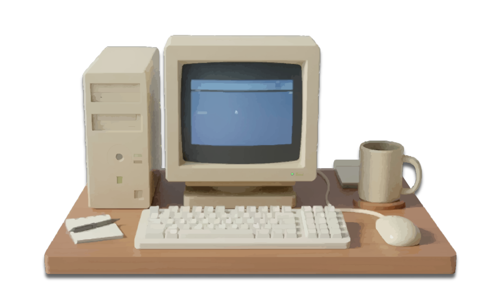

<!-- ------ README --------->

<!-- Header -->   

   <!-- light mode -->
   <!-- dark mode -->

<!-- Views -->

 
     

  <a href="https://github.com/TheBigEye#gh-light-mode-only"> 
  <a href="https://github.com/TheBigEye#gh-dark-mode-only"> 

<!-- ----------------------------------------------------------------------------------------------------------------------------------------------------------------->
- 🔭 I’m currently working on **[Monarch OS](https://github.com/TheBigEye/Monarch-OS)** and **[Aircraft](https://github.com/TheBigEye/Aircraft)**.
- ❤️ I love **[Python](https://github.com/topics/python)**, **[Java](https://github.com/topics/java)** and **[C](https://github.com/topics/c)**.
- 👀 I am focused on the development of **[Games](https://github.com/topics/game-engine)**, **[Operating Systems](https://github.com/topics/osdev)**, and **[IA](https://github.com/topics/ai)**.
- 🌱 I’m currently learning **[Rust](https://github.com/topics/rust)** and **[COBOL](https://github.com/topics/cobol)** for fun.
- 👯 I’m currently collaborating on **[Minicraft+](https://github.com/MinicraftPlus/minicraft-plus-revived)**.
- ⚡ Fun fact, I love **[Assembly](https://github.com/topics/assembly-language)**, is faster and sometimes easy to learn.
- 🎨 **Green** is my favorite color.

<!-- ----------------------------------------------------------------------------------------------------------------------------------------------------------------->

<!-- User stats -->

     <a href="https://github.com/TheBigEye#gh-light-mode-only">
          <!-- Light mode -->
          
     </a>
     <a href="https://github.com/TheBigEye#gh-dark-mode-only">
          <!-- Dark mode -->
          
     </a>

<!-- ----------------------------------------------------------------------------------------------------------------------------------------------------------------->

<!-- Top langs used -->

  <a href="https://github.com/TheBigEye#gh-light-mode-only">
      <!-- Light mode -->
      
  </a>
  <a href="https://github.com/TheBigEye#gh-dark-mode-only">
      <!-- Dark mode -->
      
  </a>

<!-- ----------------------------------------------------------------------------------------------------------------------------------------------------------------->

<!-- Contributions -->
<a href="https://github.com/TheBigEye#gh-light-mode-only">
     <!-- Light mode -->
     
</a>
<a href="https://github.com/TheBigEye#gh-dark-mode-only">
     <!-- Dark mode -->
     
</a>

<!-- -------------------------------------------------------------------------- Credits ------------------------------------------------------------------------------>
<!-- Header and footer svgs --- kyechan99/capsule-render -->
<!-- Views counter --- antonkomarev/github-profile-views-counter -->
<!-- Stats, top langs --- stats-organization/github-readme-stats-action -->
<!-- Activity graph --- maurodesouza/github-readme-activity-graph-action -->
<!-- Cards are generated by .github/workflows/readme-stats.yml -->
<!-- ---------------------------------------------------------------------------- END -------------------------------------------------------------------------------->
