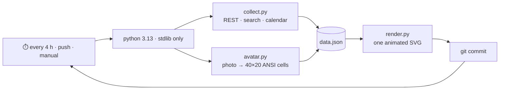

<!-- ═══════════════ ANIMATED README · generated ═══════════════ -->

  

- 🔭 I’m currently working on **[Monarch OS](https://github.com/TheBigEye/Monarch-OS)** and **[Aircraft](https://github.com/TheBigEye/Aircraft)**.
- ❤️ I love **[Python](https://github.com/topics/python)**, **[Java](https://github.com/topics/java)** and **[C](https://github.com/topics/c)**.
- 👀 I am focused on the development of **[Games](https://github.com/topics/game-engine)**, **[Operating Systems](https://github.com/topics/osdev)**, and **[IA](https://github.com/topics/ai)**.
- 🌱 I’m currently learning **[Rust](https://github.com/topics/rust)** and **[COBOL](https://github.com/topics/cobol)** for fun.
- 👯 I’m currently collaborating on **[Minicraft+](https://github.com/MinicraftPlus/minicraft-plus-revived)**.
- ⚡ Fun fact, I love **[Assembly](https://github.com/topics/assembly-language)**, is faster and sometimes easy to learn.
- 🎨 **Green** is my favorite color.

<b>▲ how this README is built</b>

| what | how | why it is not a screenshot |
| --- | --- | --- |
| **telemetry** | REST + search API, contribution calendar per day | re-collected on every run |
| **portrait** | the photo quantised to 40×20 cells of CP437 blocks | the gaze and the blink are CSS |
| **terminal** | one SVG window in the VGA console font, CSS keyframes | animation ships inside the file |

**Last build** `2026-11-21 14:55:15 UTC` · **contributions** `986` · **streak** `1d` / best `55d` · **rank** `A-` · **degraded sources** `0`

Rendered by `scripts/` from the GitHub API and the contribution calendar. Sources that fail are noted above; the rest of the README still renders.

<!-- ═════════════════════════════ END GENERATED ═════════════════════════════ -->

<!-- ─────────────────────────────── credits ───────────────────────────────
  Cards and animation: scripts/ (stdlib only)
  Typeface: Linux console font Default8x16 (CP437) — assets/readme/fonts/
  Brand marks: Simple Icons (CC0) — assets/readme/icons/brands.json
  Regenerated by .github/workflows/readme.yml
──────────────────────────────────────────────────────────────────────────── -->
